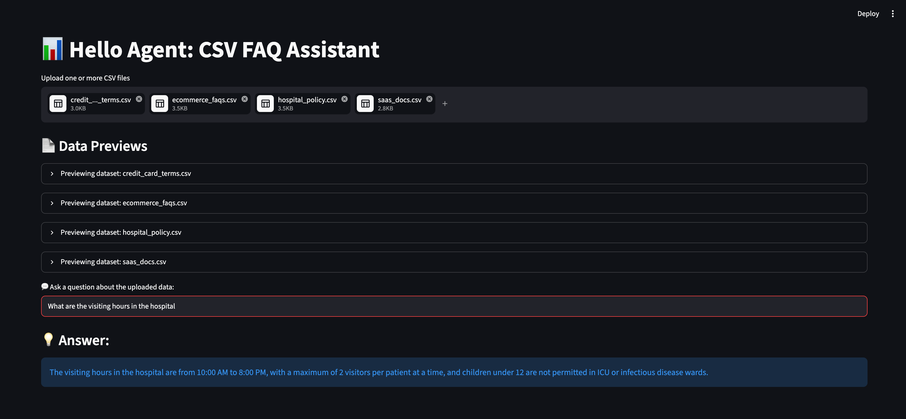

# 📊 Hello Agent: Secure CSV FAQ Assistant

A production-grade, secure internal web application designed for customer support agents, operations staff, and product managers. This tool allows users to upload multiple corporate policy or FAQ CSV files and query them using natural language. 

The application utilizes an offline, local Large Language Model (LLM) via **Ollama**, ensuring complete data privacy with no external API dependency or data leakage.

## ✨ Features
* **Multi-File Processing:** Upload multiple CSV files simultaneously with automatic data structure previews.
* **Deterministic Responses:** Enforces a strict **Data-Only Rule** using zero-shot compliance prompts to prevent AI hallucinations.
* **Enterprise Security:** Bypasses dangerous runtime string execution (`eval`/`exec`) by utilizing a declarative context engine layout.
* **Clean Object-Oriented Architecture:** Designed with modern software engineering patterns separating data ingestion, LLM orchestration, and the view layer.

---

## 🛠️ Tech Stack & Requirements
* **Python 3.10+**
* **Streamlit** (Interactive Web UI)
* **Pandas** (Data serialization)
* **LangChain Core** (LLM prompt orchestration)
* **Ollama** (Local LLM runtime environment)
* **Llama 3.2** (Lightweight 3B parameter model optimized for laptops)

---

## 🚀 Installation & Local Setup

Follow these sequential steps to run the application on your machine (optimized for macOS):

### 1. Clone the Repository & Navigate In
```bash
git clone https://github.com
cd csv-faq-agent
```

### 2. Set Up a Clean Virtual Environment
```bash
python3 -m venv env
source env/bin/activate
```

### 3. Install Dependencies
```bash
pip3 install --upgrade pip
pip3 install langchain-ollama langchain-core pandas streamlit python-dotenv
```

### 4. Configure Your Local AI Model (Ollama)
Ensure you have Ollama installed on your system. If using Homebrew on macOS, run:
```bash
brew install ollama
brew services start ollama
```
Download and cache the required model locally:
```bash
ollama run llama3.2
```
*(Once the download hits 100% and you see the `>>>` prompt, type `/exit` to return to your normal terminal).*

### 5. Launch the Web Application
```bash
python3 -m streamlit run agent.py
```

---

## 📁 Repository Structure
```text
csv-faq-agent/
├── env/               # Isolated virtual environment files (git-ignored)
├── agent.py           # Core Application Script (OOP Structure)
└── README.md          # Project documentation
```

---

## 📜 System Architecture Overview
The application relies on three strictly decoupled software components:
1. **`DocumentContextManager`**: Responsibly serializes tabular Pandas schemas into optimized plain text context feeds.
2. **`LocalFAQEngine`**: Injects strict boundaries onto the LLM, managing the LangChain Expression Language (LCEL) runtime execution pipeline.
3. **`render_ui()`**: Manages session data persistency states and handles Streamlit widget presentation nodes.


